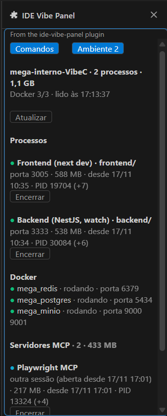

# ide-vibe-panel

[English](#english) · [Português](#português)



## English

A Claude Code mod that opens a panel next to the chat, with two tabs:

- **Commands**: the terminal commands (Bash and PowerShell) Claude runs, showing what is running right now and the status of each one.
- **Environment**: what is running from the project on your machine (backend, frontend, tests, Docker containers) and the local MCP servers.

To open the panel, type `/painel` in Claude Code.

### Where it works

The mod works in any VS Code-based IDE.
Claude Code is what runs the mod.
The IDE needs the Claude Code extension installed: VS Code, Cursor, Windsurf, VSCodium, Antigravity.

The mod also works outside an IDE: in Claude Code in the terminal (including the JetBrains terminal) and in the desktop app.

The **Environment** tab only works on Windows: it reads processes through PowerShell. The **Commands** tab works on Windows, macOS and Linux.

### How to install

At the Claude Code prompt, in the terminal:

```
/plugin install ide-vibe-panel --marketplace GustavoCastrohhh/ide-vibe-panel
```

Answer `y` to add the marketplace and choose the user scope (Enter).

From a shell:

```
claude plugin install ide-vibe-panel --marketplace GustavoCastrohhh/ide-vibe-panel
```

In the desktop app, where `/plugin` does not run: click the **+** next to the prompt box, then **Plugins**, **Add marketplace** with `GustavoCastrohhh/ide-vibe-panel`, and **Add plugin**.

After installing, start a new Claude Code conversation and type `/painel`.

## Português

Mod do Claude Code que abre um painel ao lado do chat, com duas abas:

- **Comandos**: os comandos de terminal (Bash e PowerShell) que o Claude roda, com o que está rodando agora e a situação de cada um.
- **Ambiente**: o que está rodando do projeto na máquina (backend, frontend, testes, containers do Docker) e os servidores MCP locais.

Para abrir o painel, digite `/painel` no Claude Code.

### Onde funciona

O mod funciona em qualquer IDE baseada no VS Code.
Quem roda o mod é o Claude Code.
A IDE precisa ter a extensão do Claude Code instalada: VS Code, Cursor, Windsurf, VSCodium, Antigravity.

O mod também funciona fora de IDE: no Claude Code pelo terminal (inclusive no terminal do JetBrains) e no app desktop.

A aba **Ambiente** só funciona no Windows: ela lê os processos pelo PowerShell. A aba **Comandos** funciona em Windows, Mac e Linux.

### Como instalar

No prompt do Claude Code, no terminal:

```
/plugin install ide-vibe-panel --marketplace GustavoCastrohhh/ide-vibe-panel
```

Responda `y` para adicionar o marketplace e escolha o escopo de usuário (Enter).

Por um shell:

```
claude plugin install ide-vibe-panel --marketplace GustavoCastrohhh/ide-vibe-panel
```

No app desktop, onde o `/plugin` não roda: clique no **+** ao lado da caixa do prompt, depois **Plugins**, **Add marketplace** com `GustavoCastrohhh/ide-vibe-panel` e **Add plugin**.

Depois de instalar, abra uma conversa nova do Claude Code e digite `/painel`.
